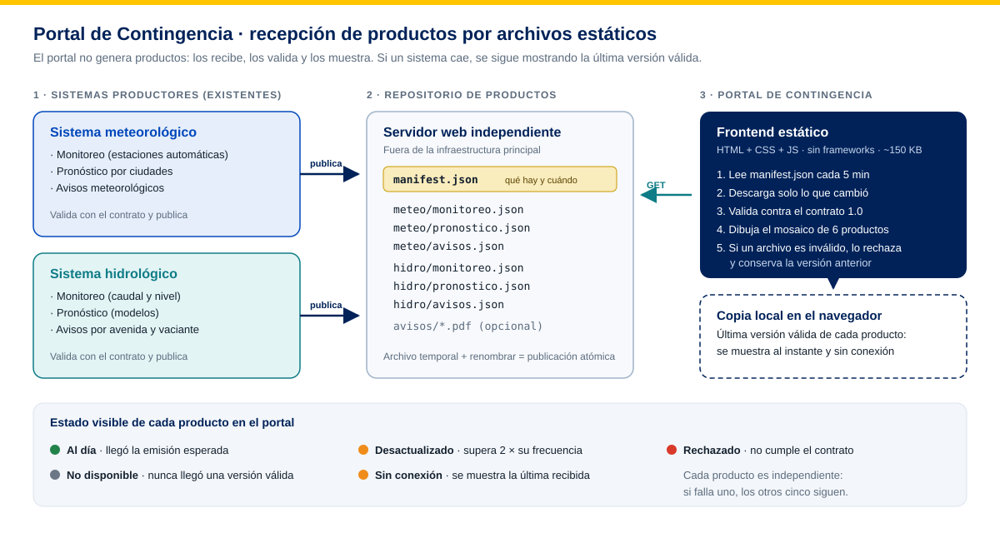
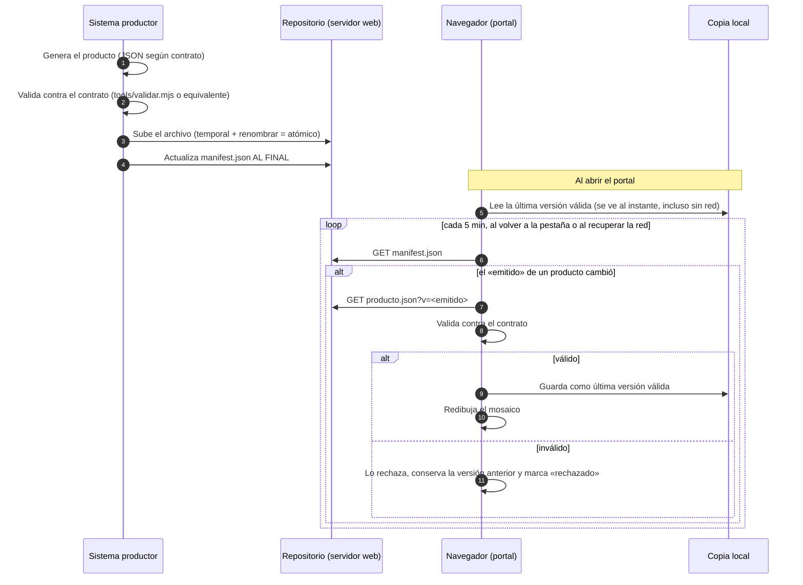

# Arquitectura del Portal de Contingencia

**Proyecto:** Sistema Informático para el apoyo a la Continuidad Operativa del SENAMHI. Fase 1, Módulo 4: versión minimalista del Portal de Contingencia (monitoreo, pronósticos y avisos).
**Versión:** 1.0, noviembre de 2026.

## 1. Propósito

El Portal de Contingencia es un **canal alterno de difusión**. Muestra en un solo mosaico los seis productos hidrometeorológicos del SENAMHI:

| | Meteorología | Hidrología |
|---|---|---|
| Monitoreo | `meteo-monitoreo` | `hidro-monitoreo` |
| Pronóstico | `meteo-pronostico` | `hidro-pronostico` |
| Avisos | `meteo-avisos` | `hidro-avisos` |

El portal **no genera productos**: los generan los sistemas productores que ya existen. El portal solo **los recibe, los valida y los muestra**. Su requisito principal es seguir funcionando cuando los sistemas centrales no están disponibles.

## 2. Decisión de arquitectura: publicación de archivos estáticos (modelo «buzón»)



```
 SISTEMAS PRODUCTORES               REPOSITORIO DE PRODUCTOS             PORTAL DE CONTINGENCIA
 (existentes)                       (servidor web independiente)         (frontend estático)

 ┌──────────────────────┐ 1.valida  ┌───────────────────────────┐  3.lee  ┌──────────────────────┐
 │ Sistema meteorológico│ 2.publica │ manifest.json             │◀─fetch──│ Mosaico (6 productos)│
 │ (monitoreo, pronóst.,├──────────▶│ meteo/monitoreo.json      │  cada   │ + vistas ampliadas   │
 │  avisos)             │  SFTP /   │ meteo/pronostico.json     │  5 min  │                      │
 └──────────────────────┘  rsync /  │ meteo/avisos.json         │         │ valida contra el     │
 ┌──────────────────────┐  carpeta  │ hidro/monitoreo.json      │         │ contrato; si falla,  │
 │ Sistema hidrológico  ├──────────▶│ hidro/pronostico.json     │         │ conserva la versión  │
 │ (monitoreo, pronóst.,│ compartida│ hidro/avisos.json         │         │ anterior             │
 │  avisos)             │           │ (+ PDF de avisos, opc.)   │         └──────────┬───────────┘
 └──────────────────────┘           └───────────────────────────┘                    │
                                                                         ┌───────────▼───────────┐
                                                                         │ Copia local (navegador)│
                                                                         │ última versión válida  │
                                                                         │ de cada producto       │
                                                                         └────────────────────────┘
```

### Alternativas evaluadas

| Criterio | **Archivos estáticos (elegida)** | API directa del sistema productor | Backend propio con base de datos |
|---|---|---|---|
| Si cae el sistema central | El portal sigue mostrando el último producto | El portal también cae | Depende de la sincronización |
| Carga ante alta concurrencia | Mínima; admite CDN o caché | Toda la carga va al sistema central | Requiere dimensionar el servidor |
| Esfuerzo para los productores | Exportar un archivo JSON | Exponer y mantener una API | Integración con el backend |
| Componentes que operar | Servidor web estático | Ninguno adicional | Servidor de aplicación y base de datos |
| Acoplamiento | Solo el **contrato de datos** | Tecnología del otro sistema | Alto |

La alternativa elegida cumple los criterios de minimalismo definidos en el análisis: bajo ancho de banda, alta concurrencia, operación mínima viable y ningún componente de servidor que mantener.

### Escala: muchas estaciones y mucho tráfico

El contrato 1.1 está pensado para más de 500 estaciones y picos de tráfico, sin nube, con Nginx en servidores de la institución:

- **Resumen y detalle separados:** el mosaico baja el valor actual de cada estación; la serie se pide solo al abrirla.
- **Menos descargas simultáneas:** consulta cada 5 minutos, espera al azar antes de bajar una emisión nueva, y las pestañas ocultas no consultan.
- **Un manifiesto por sistema:** dos productores no se pisan y la caída de uno no afecta al otro.
- **Publicación por producto:** monitoreo cuando hay datos nuevos; si dejan de llegar, el portal lo marca como desactualizado.

El límite real es el enlace de internet. Si no alcanza, se agregan servidores Nginx detrás de un balanceador o se amplía el enlace, sin cambiar el código. Antes de comprometer una cifra de usuarios hay que hacer una prueba de carga sobre la infraestructura real.

## 3. Flujo de recepción de un producto



## 4. Estados de cada producto

El portal informa la salud de cada producto en su tarjeta, en la tarjeta «Estado del servicio» y en una franja superior.

| Estado | Cuándo ocurre | Qué ve el usuario |
|---|---|---|
| **Al día** | Se recibió la emisión esperada | Punto verde y «Emitido dd/mm hh:mm · hace X» |
| **Verificando** | Al abrir el portal, mientras consulta el repositorio | Copia local, punto gris |
| **Desactualizado** | Antigüedad mayor que `frecuencia_min × 2` | Aviso naranja en la tarjeta |
| **Sin conexión** | El repositorio no responde (red o error 5xx) | Franja superior y última versión recibida |
| **Rechazado** | El archivo nuevo no cumple el contrato | Aviso rojo; se conserva la versión anterior |
| **No disponible** | Nunca se recibió una versión válida | Tarjeta «Producto no disponible» con el motivo |

Cada producto es **independiente**: si falla uno, los otros cinco siguen funcionando. Por eso cada archivo es autocontenido; por ejemplo, el pronóstico hidrológico incluye las coordenadas y los umbrales de sus estaciones y no depende del archivo de monitoreo.

## 5. Componentes del frontend

```
index.html ── js/app.js ─────────────── arranque, eventos, ciclo de actualización
               ├── js/config.js ─────── URL del repositorio, intervalo, tolerancia
               ├── js/datos/
               │    ├── contrato.js ─── esquemas y validación (compartido con tools/)
               │    ├── repositorio.js  manifiesto, descarga, rechazo, copia local, salud
               │    └── modelo.js ───── contrato → modelo de vista (escapa textos, calcula estados)
               ├── js/ui/
               │    ├── mosaico.js ──── 8 tarjetas del mosaico
               │    ├── detalle.js ──── 6 vistas ampliadas
               │    ├── graficos.js ─── mapa SVG, series, indicador de nivel
               │    ├── estado.js ───── selecciones del usuario y catálogo de productos
               │    └── util.js ─────── formato numérico SI, fechas en hora de Lima, iconos
               └── js/geo/peru.js ───── cartografía base (límites INEI)
sw.js ───────────────────────────────── abre la aplicación aunque el servidor no responda
```

**Características técnicas:**
- HTML, CSS y JavaScript estándar (módulos ES). **Sin frameworks, sin dependencias y sin compilación.**
- Peso total: aplicación de unos 150 KB más productos de unos 105 KB. No usa fuentes, librerías ni CDN externos.
- Mapas y gráficos en SVG generados en el navegador: no se descargan imágenes.
- Seguridad: todo texto que llega de un producto se **escapa** antes de insertarlo en la página (`modelo.js`). Los enlaces a documentos solo admiten `http` y `https`.
- Accesibilidad: navegación por teclado, foco visible, `aria-live` en los avisos de estado, contraste según la guía de UI y modo claro u oscuro.

## 6. Despliegue

1. **Portal:** se copia la carpeta (sin `tools/` ni `docs/`) a cualquier servidor web estático (Nginx, Apache, IIS) o a un CDN.
2. **Repositorio de productos:** una carpeta servida por HTTP con la estructura de `productos/`.
   - Si está en el **mismo servidor** que el portal, se usa `repositorio: "productos/"`.
   - Si está en **otro servidor**, se usa su URL en `js/config.js` y ese servidor debe enviar `Access-Control-Allow-Origin: <dominio del portal>`.
3. **Cabeceras recomendadas** para los manifiestos: `Cache-Control: no-cache`, con revalidación. Los productos y detalles se piden con `?v=<emitido>`: el servidor debe respetar esa consulta y puede servirlos ya comprimidos. Se recomienda HTTP/2 cuando haya HTTPS.
4. **Resiliencia recomendada:** alojar el portal y el repositorio **fuera** de la infraestructura principal (otro centro de datos o nube), porque su función es justamente operar cuando la infraestructura principal falla.

## 7. Fuera del alcance de esta fase

- Integración real con los sistemas productores. Requiere acordar con cada área el mecanismo de subida (SFTP, carpeta compartida o una API de carga) y la cuenta de servicio.
- Logotipos oficiales y datos de contacto institucionales (`js/config.js`).
- Generación de PNG y PDF desde el portal. Por ahora se usa «Imprimir», y los avisos pueden enlazar su PDF oficial con el campo `documento`.
